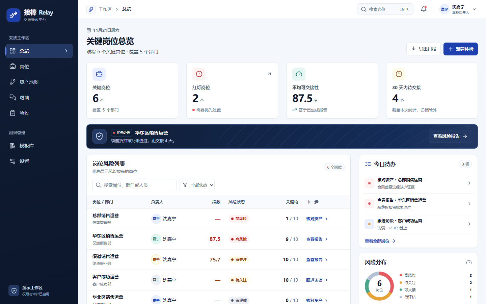
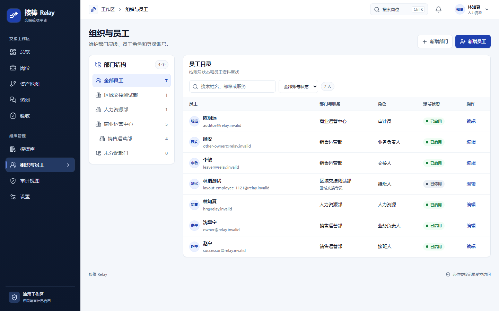
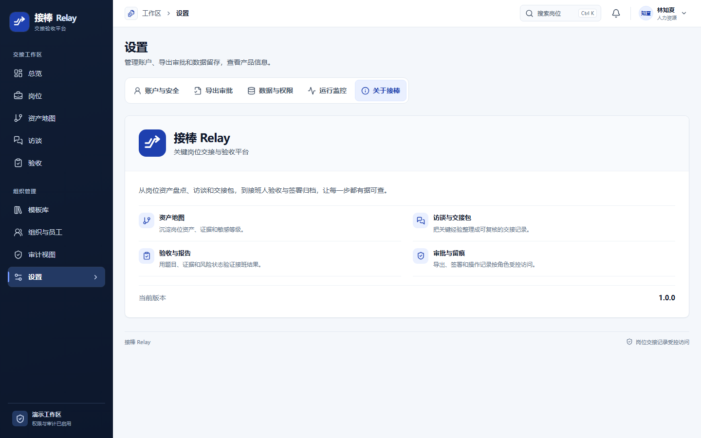

# 接棒 Relay

关键岗位交接验收平台。业务负责人盘点资产，交接人完成三轮访谈，接班人完成闭卷和开卷验收。负责人复核关键项并生成三色报告，三方手写签名后归档。系统支持组织架构、员工账号、导出审批、审计留痕和运行监控。

## 本地运行

使用 Node.js 24.4 或以上版本。在 Windows PowerShell 中执行：

```powershell
npm.cmd ci
npm.cmd run build
npm.cmd start
```

浏览器打开 `http://localhost:3000`。登录页的「业务演示」进入包含 6 个合成岗位的工作台，「管理演示」可体验组织管理。登录后可在右上角切换演示角色。演示数据保存在 `.relay`，服务仅监听本机。开发模式使用 `npm.cmd run dev`。

直接访问 `http://localhost:3000/#/settings/about` 可查看「关于接棒」页面。人力资源角色可以进入「组织与员工」维护部门层级、员工角色、登录状态和临时密码。

## 演示截图

以下截图来自本地合成演示数据，展示总览工作台、组织目录和设置中的关于页面。







## 演示路径

1. 在总览打开「华东区销售运营」。报告有实际计算出的 87.5 分，续费折扣审批未通过触发红灯和签署锁定。
2. 在「资产地图」查看 8 类条目、证据和敏感分级。访谈页可回看三轮记录，交接包支持按事项、处理人或路径检索。
3. 负责人在报告记录补交接，再切到接班人开始一次补考。提交后切回负责人完成抽检和待复核题。通过后分别切换三个角色上传手写签名。
4. 申请 PDF 或 Markdown 导出，在「设置 → 导出审批」用另一位授权人员审批，申请人下载带水印的文件。「审计视图」供人力资源和审计员查询。
5. 以人力资源角色打开「组织与员工」，新增部门和员工并设置临时密码。员工退出演示角色后可用工作邮箱登录，改密后进入工作台。开通的账号可供新建岗位时选择。

6. 在「设置 → 关于接棒」查看产品定位、核心能力和当前版本。设置分类支持窄屏布局，保存中的表单会锁定关闭操作，失败后可保留内容重试。

## 验证命令

```powershell
npm.cmd test
npm.cmd run evaluate
npm.cmd run smoke
node scripts/layout-check.mjs
```

布局验证页在 `http://localhost:3010/layout-check`，使用独立演示数据。模型接口、正式账户、Postgres、对象存储与 HTTPS 的配置见 [架构与上线手册](docs/架构与上线.md)。试点和法务材料见 [试点与合规](docs/试点与合规.md)。逐项证据与待验收项见 [交付验收](docs/交付验收.md)。

## 开源许可证

接棒 Relay 采用 [MIT 许可证](LICENSE)。
